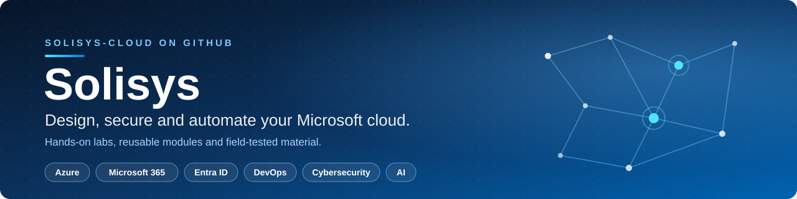
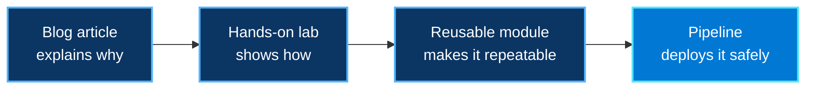

<p align="center">
  
</p>

<p align="center">
  <a href="https://www.solisys.be"></a>
  <a href="https://www.solisys.be/blog/"></a>
  <a href="https://www.linkedin.com/in/olivier-lumeau-34402214/"></a>
  <a href="https://www.solisys.be"></a>
</p>

<p align="center">
  <a href="https://github.com/Solisys-Cloud/terraform-fundamentals"></a>
  <a href="https://github.com/Solisys-Cloud/azure-static-web-app-starter"></a>
  <a href="https://github.com/Solisys-Cloud/token-anatomy"></a>
  <a href="https://www.python.org"></a>
  <a href="https://www.solisys.be/blog/terraform-azure-devops-without-secrets/"></a>
  <a href="https://github.com/Solisys-Cloud/azure-terraform-devops-lab"></a>
</p>

---

## About this repository

This repository powers the public profile of the **Solisys-Cloud** organization.
The page displayed on [github.com/Solisys-Cloud](https://github.com/Solisys-Cloud) is built from [`profile/README.md`](profile/README.md).

**Solisys** is the Belgian consultancy of **Olivier Lumeau**, Senior Azure and Microsoft 365 Architect and Security Engineer.
The blog explains the why. These repositories show the how, in code you can run in your own tenant.

## Six themes, one standard

<table>
  <tr>
    <td width="33%" valign="top">
      <h3>Azure</h3>
      Landing zones, networking and governance, written as code.<br><br>
      <a href="https://github.com/Solisys-Cloud/azure-terraform-devops-lab"></a>
    </td>
    <td width="33%" valign="top">
      <h3>Microsoft 365</h3>
      Tenant hardening, Exchange and secure collaboration.<br><br>
      <a href="https://www.solisys.be/blog/"></a>
    </td>
    <td width="33%" valign="top">
      <h3>Entra ID</h3>
      Identity, tokens, sign-in flows and Conditional Access.<br><br>
      <a href="https://github.com/Solisys-Cloud/token-anatomy"></a>
    </td>
  </tr>
  <tr>
    <td width="33%" valign="top">
      <h3>DevOps</h3>
      Terraform, Bicep and pipelines that deploy without stored secrets.<br><br>
      <a href="https://github.com/Solisys-Cloud/terraform-fundamentals"></a>
    </td>
    <td width="33%" valign="top">
      <h3>Cybersecurity</h3>
      Protocols explained, exposure checks and Zero Trust in practice.<br><br>
      <a href="https://github.com/Solisys-Cloud/tls13-explained"></a>
    </td>
    <td width="33%" valign="top">
      <h3>AI</h3>
      Artificial Intelligence on Azure: AI Search, AI Foundry and RAG (Retrieval-Augmented Generation) patterns.<br><br>
      <a href="https://www.solisys.be/blog/"></a>
    </td>
  </tr>
</table>

## How the content fits together



## Principles behind every repository

| Principle | In practice |
|---|---|
| **Reproducible** | Every lab deploys in your own subscription and is removed with a single command. |
| **Secure by default** | No secrets in code, workload identity federation for pipelines, no Terraform state in Git. |
| **Step by step** | Short guides, architecture diagrams and a validation workflow on each change. |
| **Versioned** | Reusable modules are released with Git tags, so every environment pins a known version. |
| **Open** | Labs and modules are published under the MIT licence. |

## Repository layout

```text
.github/
├── assets/
│   └── banner.svg      # Banner used in this README
├── profile/
│   └── README.md       # Organization profile page
└── README.md           # This file
```

---

<p align="center">
  <sub>Maintained by Olivier Lumeau · Solisys srl · Belgium</sub>
</p>
